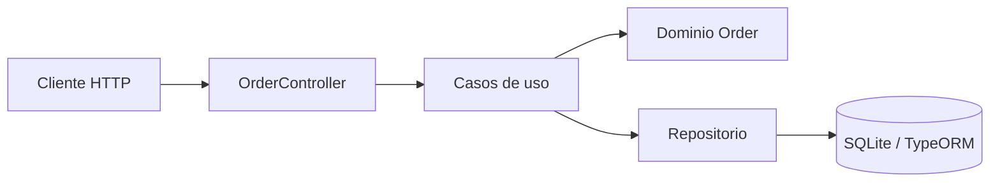

# Nexus Orders API — Gestión experimental de pedidos

Backend en **NestJS 11 y TypeScript** orientado a registrar pedidos, consultar el listado y actualizar su estado. Incluye entidades de dominio, casos de uso, controladores HTTP y persistencia local mediante **TypeORM con SQLite**.

> **Estado:** prototipo académico/técnico de API. **No es un backend multiempresa validado**, no dispone de autenticación ni autorización suficientes para exponerlo a Internet y su instalación reproducible está bloqueada actualmente por un archivo de dependencias inconsistente.

## Alcance presente en el código

| Operación | Endpoint | Estado de implementación |
|---|---|---|
| Crear pedido | `POST /orders` | Controlador que invoca `CreateOrderUseCase` |
| Listar pedidos | `GET /orders` | Consulta al repositorio |
| Completar pedido | `PATCH /orders/:id/complete` | Modifica estado de forma directa; requiere validación de reglas de dominio |

La API no debe interpretarse como una plataforma de pagos, facturación o e-commerce productiva.

## Arquitectura



| Carpeta | Función |
|---|---|
| [`src/domain/`](src/domain/) | Entidades y reglas de dominio |
| [`src/application/`](src/application/) | Casos de uso y DTO |
| [`src/presentation/`](src/presentation/) | Controladores REST |
| [`src/infrastructure/`](src/infrastructure/) | Adaptadores de persistencia |
| [`test/`](test/) | Configuración de pruebas de extremo a extremo |
| [`docs/`](docs/) | Revisión técnica, riesgos y evolución |

## Instalación y ejecución local

Requiere Node.js compatible con NestJS 11 y npm. El procedimiento esperado una vez reparado el lockfile es:

```bash
npm ci
npm run start:dev
```

Por configuración local, la API suele escuchar en `http://localhost:3000`; verificar `src/main.ts` y variables de entorno antes de usarla. La base SQLite es local, no un servicio productivo.

**Bloqueo comprobado:** GitHub Actions falla en `npm ci` porque `package-lock.json` no está sincronizado con dependencias `@emnapi/*`. **No se han ejecutado automáticamente el build ni los tests posteriores a ese fallo.** Ver [issue #2](https://github.com/andres-olguin/nexus-orders-api/issues/2) y [PR de estabilización #1](https://github.com/andres-olguin/nexus-orders-api/pull/1).

## Comprobaciones disponibles en package.json

```bash
npm test -- --runInBand
npm run build
npm run test:e2e
```

Estos son comandos definidos en el repositorio; **su presencia no demuestra resultado satisfactorio** hasta resolver primero la instalación y ejecutarlos.

## Riesgos críticos antes de un piloto

- `synchronize: true` de TypeORM puede modificar el esquema automáticamente: sustituir por migraciones versionadas.
- El endpoint para completar pedidos escribe `COMPLETED` directamente, sin aplicar todas las transiciones de estado del dominio.
- Faltan controles consistentes de autenticación, permisos y eventual aislamiento multiempresa.
- Validar cantidades, valores, clientes, errores, condiciones de carrera y acceso a pedidos por ID.
- Añadir pruebas de contratos API y seguridad antes de integrar con el dashboard.

## Frontend relacionado y hoja de ruta

El panel está en [`nexus-orders-dashboard`](https://github.com/andres-olguin/nexus-orders-dashboard). Ambos proyectos necesitan un contrato HTTP compartido y configuración de CORS cuando se ejecutan en puertos distintos.

[Revisión de ingeniería](docs/ENGINEERING_REVIEW_2026-11-04.md) · [Arquitectura y escalabilidad](docs/ARCHITECTURE_SCALABILITY_2026-11-04.md).

**Privacidad y estado comercial:** utilizar datos ficticios. No introducir pedidos de clientes reales ni afirmar disponibilidad de producción.
